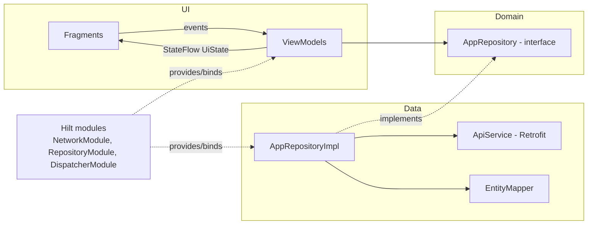

# s8139858Assignment2

Android app for **NIT3213 – Android Application Development, Assignment 2**. It authenticates a
student against the `nit3213api`, loads a dashboard of entities (books) and shows the full details
of any entity, including its description.

- **App display name:** Book (project/root name remains `s8139858Assignment2`)
- **Author:** Sulav Silwal (s8139858)
- **Repository:** https://github.com/sulavsilwal/s8139858Assignment2 *(placeholder – replace after pushing)*

## Features

- Login screen with validation, masked password with show/hide toggle, progress indicator and
  user-friendly error messages (invalid credentials, no internet, timeout, server error, malformed response)
- Cold-start hint ("Server may be waking up…") if the free-tier API takes more than ~5 seconds,
  with 60-second network timeouts
- Dashboard with `RecyclerView` (`ListAdapter` + `DiffUtil`), entity summaries (no description),
  `entityTotal` header, loading / empty / error-with-retry states, and rotation-safe state
- Details screen showing **all** entity fields plus the description in scrollable Material cards
- Light and dark (DayNight) Material 3 themes

## Tech stack (exact versions)

| Component | Version |
|---|---|
| Gradle | 8.10.2 |
| Android Gradle Plugin | 8.7.3 |
| Kotlin | 2.0.21 |
| KSP | 2.0.21-1.0.28 |
| Hilt | 2.51.1 |
| Navigation (Safe Args) | 2.8.4 |
| Retrofit / Gson converter | 2.11.0 |
| OkHttp (+ logging interceptor) | 4.12.0 |
| Gson | 2.11.0 |
| Coroutines | 1.9.0 |
| Lifecycle | 2.8.7 |
| Material Components | 1.12.0 |
| RecyclerView | 1.4.0 |
| compileSdk / targetSdk / minSdk | 35 / 35 / 24 |
| Tests: JUnit / MockK / coroutines-test / MockWebServer / Turbine / Truth | 4.13.2 / 1.13.13 / 1.9.0 / 4.12.0 / 1.2.0 / 1.4.4 |

All versions are declared once in `gradle/libs.versions.toml` (version catalog).

## Architecture

MVVM with clean layering and unidirectional data flow:



- **ui/** — Fragments only render `UiState` and forward events; ViewModels hold state in `StateFlow`
  and emit one-shot events via a `Channel`.
- **domain/** — framework-free models (`Entity`, `EntityField`, `DashboardData`) and the
  `AppRepository` interface.
- **data/** — Retrofit `ApiService`, DTOs, the dynamic `EntityMapper` and the repository
  implementation with centralised error mapping (`safeApiCall`).

### Why dynamic entity mapping?

The assignment spec only documents generic entity fields (`property1`, `property2`, `description`)
because the fields depend on the `keypass` topic. Entities are therefore parsed as order-preserving
`JsonObject`s and mapped to `Entity(id, fields, description)`:

- `fields` = every non-description property, in original JSON order, with humanised labels
  (`publicationYear` → `Publication Year`) and null-safe values (`null` → `-`)
- `description` = separated out, so dashboard rows never show it and Details always can

Verified against the live API for this student: keypass `books` returns 7 entities with
`title`, `author`, `genre`, `publicationYear`, `description` — the dynamic mapper handles that
shape with no hardcoded schema.

## Package structure

```
com.s8139858.assignment2
├── AppApplication.kt          (@HiltAndroidApp)
├── di/
│   ├── NetworkModule.kt       (OkHttp, Retrofit, Gson, ApiService — @Singleton)
│   ├── RepositoryModule.kt    (@Binds AppRepository -> AppRepositoryImpl)
│   └── DispatcherModule.kt    (@IoDispatcher / @DefaultDispatcher qualifiers)
├── data/
│   ├── remote/                (ApiService, dto/)
│   ├── mapper/EntityMapper.kt
│   └── repository/AppRepositoryImpl.kt
├── domain/
│   ├── model/                 (Entity, EntityField, DashboardData)
│   └── repository/AppRepository.kt
├── ui/
│   ├── MainActivity.kt        (single Activity + NavHost + toolbar)
│   ├── login/                 (Fragment, ViewModel, UiState + events)
│   ├── dashboard/             (Fragment, ViewModel, UiState, EntityAdapter)
│   └── details/               (Fragment, ViewModel)
└── util/                      (ApiResult, AppError, error mapping, safeApiCall)
```

## API endpoints

Base URL: `https://nit3213apinew.onrender.com/` (provided via `BuildConfig.BASE_URL` →
`NetworkModule`, never hardcoded in Retrofit code)

| Endpoint | Method | Body / Params | Success |
|---|---|---|---|
| `/sydney/auth` | POST | `{"username": "<student number>", "password": "<first name>"}` | `{"keypass": "books"}` |
| `/dashboard/{keypass}` | GET | path: keypass from login | `{"entities": [...], "entityTotal": 7}` |

> Note: the API answers **invalid credentials with HTTP 404** (verified against the live server),
> so 401/403/404 all map to the "invalid credentials" message.

## Dependency injection

Hilt, constructor injection only — no manual singletons or service locators.

- `@HiltAndroidApp` on `AppApplication`; `@AndroidEntryPoint` on `MainActivity` and every Fragment;
  `@HiltViewModel` with `@Inject` constructors for all ViewModels.
- `NetworkModule` (`SingletonComponent`): provides `@Named("baseUrl")`, `@Named("campus")`,
  `Gson`, `OkHttpClient` (60 s timeouts; logging interceptor in debug only), `Retrofit` and
  `ApiService` as `@Singleton`s.
- `RepositoryModule` (`SingletonComponent`): `@Binds` `AppRepository` → `AppRepositoryImpl`
  (`@Singleton`).
- `DispatcherModule` (`SingletonComponent`): provides `Dispatchers.IO` / `Default` behind custom
  `@IoDispatcher` / `@DefaultDispatcher` qualifiers, so tests can inject `TestDispatcher`s.
- Because ViewModels depend on the `AppRepository` **interface**, unit tests inject a MockK fake
  without touching the network.

## Prerequisites

- Android Studio Ladybug (2024.2) or newer
- JDK 17
- Android SDK Platform 35 (installed via SDK Manager)

## Build & run

```bash
git clone <your-repo-url>
cd s8139858Assignment2
# Open the project folder in Android Studio and let Gradle sync
./gradlew assembleDebug        # or Run ▶ on an emulator/device (API 24+)
```

## How to log in

- **Username:** your student number **without the leading "s"** — for this project: `8139858`
  (7 digits, exactly as registered in the API; no leading zero is added)
- **Password:** your first name, case-sensitive — `Sulav`
- Class location: **sydney** (endpoint `/sydney/auth`)

## Running the tests

```bash
./gradlew test          # JVM unit tests: ViewModels, repository (MockWebServer), EntityMapper
```

Coverage: `LoginViewModel` (validation, success, 401/no-network/timeout, loading transitions,
leading-zero preservation), `DashboardViewModel` (success, empty, error → retry, loading,
`entityTotal`), `AppRepositoryImpl` (request path/body, DTO → domain mapping, HTTP 401/404/500,
timeout, IO errors), `EntityMapper` (ordering, description separation, null/missing/extra/nested
fields, label humanising), `DetailsViewModel`.

## Render cold start

The API runs on a free-tier Render instance and can take **30–60 seconds** to wake up. The app
uses 60-second connect/read/write timeouts and shows a "Server may be waking up, please wait…"
hint if the login call takes more than ~5 seconds.

## Screenshots

| Login | Dashboard | Details |
|---|---|---|
| *(screenshot placeholder)* | *(screenshot placeholder)* | *(screenshot placeholder)* |

## Known limitations

- No authentication persistence — closing the app requires logging in again.
- Entity fields are rendered generically; there is no topic-specific formatting (by design, because
  the field set is defined by the server).
